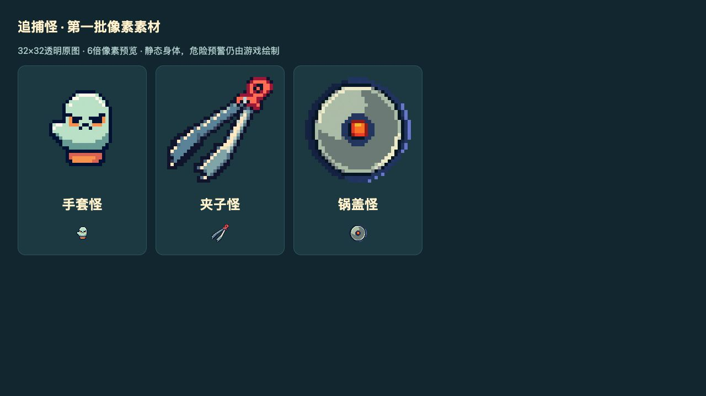

# 第一批普通敌人像素素材

原图在 [enemies资源目录](../../../assets/resources/enemies/)，3张32×32透明PNG，Creator自动生成meta；[来源/任务/种子与哈希](sources.json)供接续。

- 手套：浅青手套/橙色袖口，36世界单位。
- 夹子：细长银色金属夹/红色把手，36世界单位；原图夹口朝左下，运行时加135度偏移使夹口对准追击/锁定方向。
- 锅盖：圆形金属盖/橙色中央旋钮，48世界单位。首版误画成戴盖鸭，已拒用并重做；来源记录保留失败任务ID，运行只使用重做图。

本批PixelLab Pixen共4次生成（手套此前1次＋本轮夹子/锅盖/锅盖修正3次）。原图保留不重绘，预览通过CSS像素放大。当前是静态身体，没有专用行走/冲刺/压盖动画。

GoDuck加载原始纹理并最近邻显示，复用最多160个可见敌人Sprite；暂停/结算隐藏，缺图回退程序绘制。规则、碰撞半径、伤害及刷怪不变。原红线/红圈和入场圈仍由Graphics绘制，部分位置会被敌人身体覆盖，密集怪群/手机预警可读性待验证。

网页实际观察约80秒的三类混合怪群、升级与装备出现；没有完整验收所有预警/冲刺时刻、满160性能或iPhone。Boss、背景和技能特效继续程序图形。
